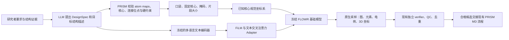

# PRISM-Design M1：可复用的文本条件片段重建训练

版本：2026-10-13。实现位于 `prism/design/m1/`。这份文档区分已实现的训练接口和需要后续数据/实验支持的能力；短训练成功不代表分子优化有效。

## 1. 这批数据能训练什么

本轮按 PDB 文件夹名的 ASCII 升序选前 2000 个复合物，排除后不补齐到 2000。数据和逐条判读在 `PRISM_Design/pdbbind2020_first2000_round02/`。

| 数据层 | 数量 | 用途 |
|---|---:|---|
| 逐条决策记录 | 2000 | 包括失败、排除和保留理由 |
| 可解析且完成图结构判读 | 1843 | 另外 157 个源图失败，未伪称已确认结构 |
| 肽/含明确肽链的偶联物 | 378 | 排除 |
| 肽模拟物或其他化学身份存疑 | 120 | 隔离，不能算已确认非肽 |
| 判为非多肽 | 1345 | 还需源结构质量门控 |
| 通过当前源质量门槛的结构描述 | 925 | `observed_structure_caption` |
| 有合法重建划分且通过结构输入协议 | 655 | `m1_dataset/records.jsonl` |
| 通过实际 FLOWR 和 tokenizer 预检 | 612 | `m1_dataset/native_records.jsonl`；训练 458，验证 97，测试 57 |

从 925 到 655：180 个没有满足当前局部编辑/立体保护限制的划分，78 个保留了定义立体信息的显式氢，12 个源 PDB 缺少元素字段。在生成划分时共拒绝 1192 个不安全切口，其中 1124 个涉及固定端手性中心，68 个跨双键立体定义。从 655 到 612 的实际输入问题，具体原因保存在 `m1_native_preflight/excluded.json`。不偷偷删掉口袋离子，也不修图后冒充原结构。

**训练任务是 D1：给定口袋、固定核心、目标片段原子数、目标结构的文字描述，重建被遮住的片段。** 同一已观察结构的 caption 是合法的条件重建标签；不是“原分子 → 更优分子”的配对。

这批数据不包含：优化前后实测配对、可靠的 ΔpKd、溶解度变化、毒性变化、语言 token 与原子的专家对齐标签。代码拒绝把别的 task/label_kind 当成 D1。不能将“降低 logP”写在原结构上就当成功优化监督。

## 2. LLM、文本编码器、生成器各自做什么



- **LLM**：根据结构证据提出设计要求并定位。M1 训练/采样本身不调用外部 API，也不需要训练一个 LLM；可以由用户/本助手产生 JSON 和文字，交给 `validate/compile/run`。另有独立的 [LLM 编辑规划入口](README.md#llm-编辑规划器)，支持配置在线/本地模型或导入离线响应，在现有审阅范围内产生可执行的图编辑。它不自动更新 M1 权重，也不把编辑图当成 FLOWR 已支持的精确图条件。
- **文本编码器**：冻结 `sentence-transformers/paraphrase-multilingual-MiniLM-L12-v2`，revision `e8f8c211226b894fcb81acc59f3b34ba3efd5f42`。使用 384 维 token hidden states；不是重新训练通用语言理解模型。最大 128 tokens，超长直接报错，不静默截断约束。模型卡支持多语言和这个长度设置：[官方模型卡](https://huggingface.co/sentence-transformers/paraphrase-multilingual-MiniLM-L12-v2)。
- **生成底座**：固定 FLOWR.root commit `739a33c2aab74d074dd24605b9a2e34dc809ae9c`，由 `backends.py` 校验，权重为 `flowr_root_v2.2.ckpt`，SHA-256 `b818f41dc12ffb6bc558bb0ad997055581e07cd9e49dcac1b794ed9993c46e4c`。不要以不断更新的 main 代替它。
- **新训练部分**：默认仅 1,643,904 个 Adapter 参数；当前底座约 50,281,600 参数全部冻结。可选显式指定解码器 invariant Linear 的 LoRA。

本轮模型只学 D1 描述条件。涉及“更强活性/更低毒性”的 LLM 要求仍是待检验假设；M0 的确定性属性检验可以判断是否满足某项约束，不能替代优化配对训练。

## 3. 文本确实进入生成网络

`NativeTextConditioner` 挂在原生 `gen.ligand_dec.inv_emb` 的输出。口袋编码、等变坐标通道和后续解码器仍使用原生实现。当前节点 invariant 维度为 512。

对节点不变量 h 和文本 token T：

```
pool = masked_mean(T)
h' = h + gamma(pool) * LayerNorm(h) + beta(pool)
       + MultiHeadAttention(Q=LayerNorm(h), K=W*T, V=W*T)
```

更新仅施加到有效原子。padding token 不参与均值或注意力。10% 整句条件丢弃使用可学习 null token；不能给 softmax 一个全遮蔽的 token 序列。

固定连接原子另有一个可学习 invariant 向量，其标记来自 `attachment_fixed`，不依赖文字，也不在 classifier-free 文本 dropout 时丢弃。可变端的答案原子身份不作为条件输入。

FiLM 的最终线性层、attention 的输出投影和连接位点向量零初始化，初始等于**使用同一核心坐标规范化的冻结基础模型**。没有再乘一个同时为零的 gate，以免第一步所有梯度消失。第一步输出投影有梯度，后续梯度才能到达内部文本投影。

文本只改变 invariant 通道，不直接产生 xyz 偏置。不过不能仅凭通道名称声称整个上游模型严格等变：实际检查发现 pinned `LigandDecoder.forward` 将 `times_cont` 直接 broadcast 加到三个 xyz 分量（`pocket.py` 793 行附近）。原始底座的 90° 旋转测试最大坐标偏差约 0.066 Å。

`frame.py` 为 M1 增加确定性的右手核心坐标系：只从按绑定顺序排列的固定原子选不重合、不共线的三点，正交归一得到 B；全部配体/口袋/自条件坐标变换为 xB，网络输出再乘 Bᵀ。不能使用未知片段建立坐标系；退化/共线核心明确报错。所有原生预计算口袋特征在该层弃用，在新坐标系重算，避免缓存造成隐蔽的不一致。所有 612 个样本的全部候选掩码已做核心坐标系检查。

核心坐标构造和变换使用 float64，原生网络仍使用设定的 FP32/BF16；M1 的 FP32 矩阵乘法显式设为 highest，训练和推理一致。这样保留底座参数和源代码，在数学构造上消除全局 SO(3) 朝向依赖。实际原生 FP32 前向并非逐位一致：90° 检查为零误差，随机旋转仍有浮点差异；本轮记录坐标最大误差、坐标 RMS 和类别概率误差，而不把所有 raw logits 的 1e-3 绝对阈值当成已通过。详见交付目录 `m1_native_checks/report.json`。该检查只覆盖所测输入/旋转，不能替代整个数据集的数值稳定性评价。规范化的零 Adapter 基线应单独加入消融；它与未加规范化的原始 M0 不完全相同。坐标系依赖绑定的核心原子顺序，不宣称对重新编号的对称核心仍选同一坐标系。训练可施加共同 SO(3) 旋转用于一致性检查，规范化会消除这种等价朝向；禁止镜像反射。

冻结底座指 `requires_grad=False`；**训练前向不能把整个底座放在 `no_grad()` 中**，否则 Adapter 无法通过后续层接收梯度。模型保持 eval 模式冻结随机 dropout，Adapter 单独 train。暂不支持跨 ContextVar 条件作用域的 activation checkpointing、多卡 DDP 或自动模块融合。

## 4. 无目标姿态泄漏的训练构造

每条记录是实际观察到的干净 x1。每次取一个合法掩码：固定核心至少 5 个重原子，可变片段 2–12 个、不超过总数 40%；两部分连通且只有一个非环单键连接。源 atom map 与后端重原子 index 单独转换，氢不能导致编号漂移。

1. 验证所有原始文件 SHA-256、单构象、图、map、掩码和分组信息。
2. 原生预处理后，逐原子检查元素、坐标和从 3D 感知的立体身份。FLOWR `GeometricMol` 不携带 RDKit 手性标签；在核验副本上从原有坐标感知标签，不修复/对齐坐标。
3. 所有坐标以已提供的口袋质心平移；不使用完整目标配体的质心。
4. 用原生类别噪声先验及 Gaussian 坐标噪声采样 x0。可变噪声只平移到**已知固定核心质心**。
5. 固定原子坐标/元素/电荷、F–F 键来自已知核心；F–U 和 U–U 键仍是噪声。
6. `t ~ Uniform(0,1)`，坐标 `xt=(1-t)x0+t*x1`；元素、电荷、键使用底座对应的原生 unmask 类别插值。实际实例必须是 `inference=False`。
7. 训练输出是干净 x1（坐标及类别 logits），**不是速度 v**。不把 flow matching 和 diffusion epsilon loss 混用。

上游局部训练先验原本将噪声中心放在被遮挡的目标片段质心，会泄漏答案的位置。本实现只覆写这一个局部先验方法，并关闭 target-dependent permutation/rotation alignment、OT、anisotropic target prior、reference ligand COM prior。M1 推理使用相同的固定核心先验。

自条件使用噪声初态/零类别或当前模型无梯度预测，概率默认 0.5。不给可变原子输入干净目标图、目标接触标签或目标坐标。已知片段大小是显式条件；当前不学习一个长度预测器，也不据此宣称任意分子大小生成。

## 5. 损失与掩码

```
U = valid_atom AND NOT fixed_atom
E = valid_i AND valid_j AND (U_i OR U_j) AND i < j
L = lambda_x * mean_per_example(sum_xyz((x1_hat-x1)^2), U)
  + lambda_a * CE(atom_logits, atom_target)[U]
  + lambda_q * CE(charge_logits, charge_target)[U]
  + lambda_b * CE(bond_logits, bond_target)[E]
```

每一项先按每个样本有效项数归一化，再对 batch 取均值。F–U 边界键参与监督；F–F、对角线、padding 不参与。既监督存在的键，也监督“无键”；单独忽略无键会导致过度连边。原生 target 的全零无边表示经 argmax 对应类别 0，不能与 prior 的 one-hot 无键向量逐浮点比较来判断化学变化。

当前默认四项权重均为 1，坐标单位与底座一致（coord_scale=1）。这是起始超参数，不是已优化权重；根据验证集分项损失调整，不能看测试集选权重。非有限损失/梯度直接失败。当前没有 affinity、RL/DPO 或 docking 可微损失。

`alignment_set_loss` 提供可选的集合式 grounding 原语：对一个被标注 token 的等价/对称原子集合求概率和；缺失标签不作负例。**当前训练循环没有对齐标签，因此没有启用该项，也不声称已学会原子级语言定位。** 将来加入时需定义 tokenizer offset 与原子映射契约，并真实标注，而非从 attention 反推“真值”。

## 6. 阶段 A / B 与恢复细节

| 项目 | 默认实现 / 建议 |
|---|---|
| A | 冻结编码器与底座，只训练 Adapter，AdamW lr=1e-4 |
| B | 在 A 的结果得到独立验证后，配置 `lora_targets` 精确模块名，lr=1e-5，rank=8，alpha=16 |
| LoRA | `W*x + (alpha/r)*B*A*x`；A Kaiming，B=0；不修改向量几何操作 |
| 权重衰减 | 0.01；本实现对训练参数统一应用，未采用隐含的偏置排除规则 |
| batch | 1，梯度累积 8 个完整 microbatches；无最后不完整窗口的欠权重问题 |
| LR | linear warmup + cosine，按 optimizer step 更新，不按 microbatch 更新 |
| 梯度 | clip norm=1，保存裁剪前范数 |
| 精度 | 默认 FP32；可在支持的 CUDA 上显式 BF16 autocast；不提供无 GradScaler 的 FP16 |
| 验证 | 固定验证 seed、噪声/时间采样与第一个掩码；保存/恢复训练 RNG，避免验证改变训练序列 |
| 选择 | val total loss 选 best；10 次验证不改善提前停；从不以训练损失选最优 |
| 恢复 | 保存 Adapter、LoRA、optimizer、scheduler、CPU/CUDA/NumPy/Python RNG、样本顺序和游标、step、best |
| 绑定 | manifest/split、基础权重、FLOWR commit、文本模型及 tokenizer 文件、M1 Python 实现 SHA-256 |

`lora_targets` 不允许模糊匹配；必须是 `gen.ligand_dec.*` 下包含 `inv` 的真实 Linear，缺失或重复目标会报错。实际允许模块和尺寸在预检的 `invariant_linear_modules.json`。微调实现没有引入 PEFT 依赖；参数化遵循 [Hugging Face LoRA 文档](https://huggingface.co/docs/peft/main/package_reference/lora)。

**阶段 B 的新训练启动**不能直接用 `--resume` 改 A 的配置；严格恢复会拒绝不一致的 LoRA 结构/学习率/数据绑定。当前入口实现的是“从固定底座训练 Adapter + 可选 LoRA”及“完全相同配置的断点恢复”。跨阶段 warm-start 和参数迁移需显式实现与验证后再加入；不要把恢复开关误当成迁移接口。当前 612 条数据不建议全参数微调。

## 7. 数据划分和科学评价

不是逐行随机拆分。相同 complex、标准化化学身份、Murcko scaffold、蛋白分组的任一关系建立连接，整个连通分量只能去一个 split。同结构不同姿态、立体异构体、同义描述不能跨 split。无环分子的空 scaffold 用各自化学身份代替，避免所有无环分子误合并。

化学标准化只用于分组，不改训练图。RDKit tautomer 标准化有枚举上限；该分组不应被描述成穷尽所有互变异构体的证明。蛋白分组目前使用源 protein 的精确链序列和主要 CSV 的 UniProt；**没有完成 30% 序列同源聚类，不是严格 homolog-disjoint benchmark**。正式评价应导入经覆盖率约束的序列聚类 ID 到 `protein_groups`，重新从全部记录建连通分量。

本次实际 458/97/57 而非刚好 80/10/10，是保持分组完整的结果。上游预训练是否已见这些 PDBbind 复合物尚不清楚；这个集合适合研发与重建验证，不是去污染的新靶点外推基准。最终测试集仅用于预注册的最终一次评价；训练预检可检查文件可用性，但不能据其生成性能选超参数。

短训练首先验收：有限非零梯度、冻结参数无梯度、权重有变化、文本切换改变原生输出、旋转一致性、可重复恢复、原生采样调用和独立验证。

正式实验至少比较：原始 M0；相同核心坐标规范化但零 Adapter 的冻结基线；M1 正确文本；空文本；打乱文本；仅结构化约束；Adapter 与 Adapter+LoRA。固定每个请求的原始采样数量、种子、步数和硬约束。报告全部原始槽位的化学有效率、核心/连接/电荷/立体保持率、约束成功率、独特新结构数、坐标冲突率及按蛋白/骨架分组的置信区间。未完成这些实验前，不称语言带来性能提升。

## 8. 别人怎样换数据训练

标准是 `schemas/m1-record-v1.json` 和 `m1/data.py`；后者执行文件、化学图、掩码及分组的跨字段验证。每条 JSONL：

- `schema: prism-design-m1-record/1`，唯一 `record_id`，同一复合物的 `complex_group`。
- `task: fragment_reconstruction`，`label_kind: observed_structure_caption`，自然语言 `text`。
- `review`：completed / nonpeptide / quality_pass=true 以及真实审阅来源。不能自动假装人工审阅。
- `files.reference/pocket/protein`：相对 JSONL 所在目录的路径和 SHA-256。reference 为具有原始 atom map 和原构象的 SDF；pocket/protein 同一坐标系。
- `atom_maps`：按 reference 重原子顺序列出原始编号。
- `mask_candidates`：多个 `{fixed, variable, attachment_fixed, attachment_variable}`，都是原始 map。
- `split_keys`：`chemical_identity`、`scaffold`、非空 `protein_groups`。用 `chemical_keys()` 生成前两项；有同源簇时增加分组键，不删除已有保护键。
- `provenance`：数据来源、标注版本和证据类型。允许换成英文/其他语言的真实描述；同义改写必须跟母样本分组。

不使用 PDB ID、SMILES 全串、答案的坐标或亲和力字段作为条件文字。本轮保留完整结构描述允许模型学习目标组成；它不会凭空提供相对参考配体的属性改善知识。

```bash
# PRISM 主环境：本轮已有 design 依赖
python -m prism.design dataset-check --manifest /data/records.jsonl --split-output /data/split.json

# 复制 prism/configs/design.m1.example.json，填写本地路径
# 由 CLI 启动 backend_config 指向的独立原生环境
OMP_NUM_THREADS=4 python -m prism.design preflight --config /data/train.json --output /data/preflight

# 把 config 的 manifest/split 指向预检生成的 native_records/native_split
OMP_NUM_THREADS=4 python -m prism.design train --config /data/train.json
OMP_NUM_THREADS=4 python -m prism.design train --config /data/train.json --resume /runs/m1/last.pt
```

原生环境使用已经安装并通过固定 revision 校验的 FLOWR；额外文本依赖见 `m1/requirements.txt`。先下载指定 encoder revision 到 `local_path`，训练时只读本地文件。训练 config 的其他路径相对 config 文件，文本 `local_path` 建议写绝对路径。可迁移整个 `m1_dataset` 目录，它的结构引用是相对路径；原始来源审计文件无需作为训练器输入。

## 9. 与当前 PRISM 集成

训练输出 `best.pt` 只包含增量权重与恢复状态，不复制巨大的基础 checkpoint。将以下对象加入现有 FLOWR backend JSON：

```json
"m1": {
  "checkpoint": "/runs/m1/best.pt",
  "checkpoint_sha256": "实际文件SHA256",
  "instruction_file": "/requests/target_structure.txt",
  "instruction_sha256": "实际文字文件SHA256"
}
```

原有 `prism design run --spec ... --backend-config ... --output ...` 继续编译 DesignSpec、原生采样、逐槽验证和交接 MD。M1 在原生采样每一次解码器前向中注入文字，**不是生成完再按文字重排**。指令文件与 Adapter 文件在启动时和子进程中都重新核对 hash。

当前 M1 推理只接受 `fragment_replacement`；片段生长仍可用不含 `m1` 配置的 M0。文字空串对应已训练的 null 分支。classifier-free dropout 已有，采样只用 guidance scale=1，没有把未验证的 logits 外推包装成可用 CFG 调节功能。所有候选仍必须通过原有硬约束；语言条件不授权放宽核心、连接位点或坐标容差。

## 10. 后续最值得做的事

先抽查本轮更正清单及存疑结构，补齐原始解析失败/冲突，并增加蛋白同源分组。随后用这个框架完成按验证集选模的小规模 A 阶段实验及文本消融。若重建条件确实有用，再扩大高质量非肽结构描述数据。

真正训练“如何改得更好”需要 D2 数据：同蛋白、可对应固定核心的参考→目标分子对、目标姿态、条件方向及明确证据来源/测量协议。实测差值、计算代理值和 LLM 建议分开存；没有成功目标的建议不能当正标签。D2、偏好优化、多参数目标、共价/金属/大环协议是下一阶段，不属于当前已实现的 D1 训练入口。
